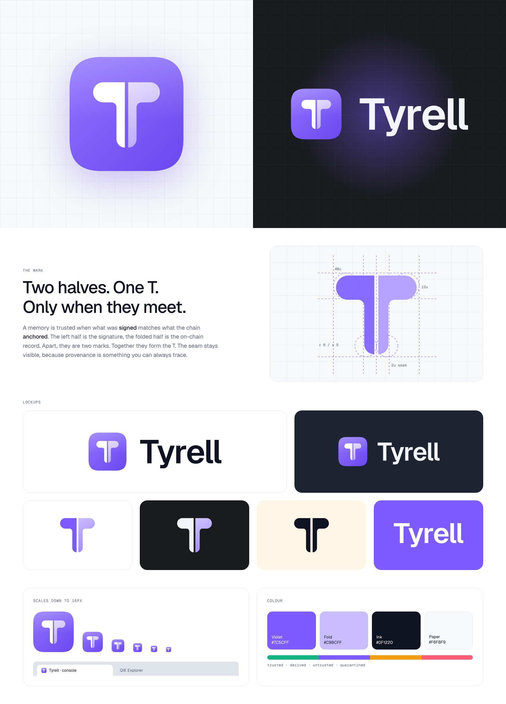

# Tyrell brand

**The mark is a T made of two halves.** The left half is what was signed. The folded half is what the chain anchored. They only form the letter when they meet, which is the rule Tyrell enforces on every memory. The seam stays visible, because provenance is something you can always trace.

| File (in `apps/web/public/brand/`) | Use |
|---|---|
| `tyrell-mark.svg` | App icon, avatars, favicon (`apps/web/app/icon.svg`) |
| `tyrell-lockup.svg` / `tyrell-lockup-dark.svg` | Mark and wordmark, for light and dark backgrounds |
| `tyrell-glyph.svg` / `tyrell-glyph-dark.svg` | The T without its tile |
| `tyrell-glyph-mono.svg` | One colour (print, stamps, embossing). The seam widens to 2.6 units so it survives |
| `tyrell-wordmark.svg` | The name alone |

**Geometry (64-unit grid).**
- The bar is 40 × 12 with round ends (r 6). The stem is 12 wide with a 2-unit seam and a round foot (r 5). Inner fillets are r 3.
- The glyph sits at 94% inside a continuous-corner tile.
- In the lockup, the mark is 1.62× the wordmark's cap height, with a gap of 0.36× the mark.

**Colour.**
- Violet `#7C5CFF` (tile gradient `#8F72FF` → `#6A48F0`), fold `#E6DEFF` → `#B5A1FF`, ink `#0F1220`, paper `#F6F8F9`.
- The footer stripes are Tyrell's trust classes: trusted `#14B37F`, derived `#6E4CF0`, untrusted `#F59E0B`.

**Wordmark.** Geist SemiBold (SIL Open Font License), tracked −0.045em, with "Ty" kerned optically. It is outlined, so it renders the same everywhere.

**Regenerate.**
1. Outline the wordmark (needs `fonttools`): `python outline.py <Geist-SemiBold.ttf> word.json`
2. Build the SVGs: `python build.py <out-dir>`
3. Copy the geometry into `apps/web/components/brand.ts`.

Don't recolour the halves to the same tone on the tile, rotate the mark, close the seam, or set the wordmark in another typeface.
